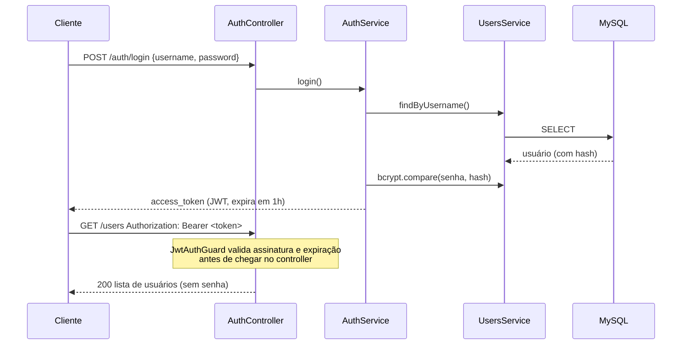

# NestJS Users API

    

API REST de usuários com cadastro, login e rotas protegidas por JWT. Pequena de propósito: o foco foi fazer a parte de autenticação e validação do jeito certo, não ter muitas rotas.

Desafio da formação **Engenheiro de Software (Escola DNC)**, entregue e aprovado na avaliação do projeto.

## Como a autenticação funciona



## O que tem de cuidado aqui

- **Senha nunca sai da API.** O hash (bcrypt, 10 rounds) fica no banco, e todo retorno do service remove o campo `password` antes de responder. O tipo de retorno (`Omit<User, 'password'>`) garante isso em tempo de compilação.
- **Validação na entrada, não no meio do código.** DTOs com `class-validator` e um `ValidationPipe` global com `whitelist` e `forbidNonWhitelisted`: campo que não está no DTO é recusado com 400, em vez de ser ignorado em silêncio.
- **Erros previsíveis.** Username ou e-mail duplicado retorna 409 (`ConflictException`), ID inexistente retorna 404. Um filtro global padroniza o corpo de erro, então o front sempre recebe o mesmo formato.
- **Login sem dar pista.** Usuário inexistente e senha errada retornam a mesma mensagem ("Credenciais inválidas"), para não revelar quais usernames existem.

## O que aprendi

- A arquitetura do Nest: módulos, injeção de dependência, controllers finos e services com a regra
- Passport + JWT na prática: strategy, guard e o que vai (e o que não vai) no payload do token
- Por que validar com DTO + pipe global em vez de `if` espalhado pelos controllers
- Mapear entidade com TypeORM e deixar unicidade (username, e-mail) também no banco, não só no código

## Endpoints

| Método | Rota | Descrição | Auth |
|---|---|---|---|
| POST | `/auth/login` | Login, devolve o JWT | – |
| POST | `/users` | Cadastro de usuário | – |
| GET | `/users` | Lista usuários | JWT |
| GET | `/users/:id` | Busca por ID | JWT |
| PUT | `/users/:id` | Atualiza (re-hash se a senha mudar) | JWT |
| DELETE | `/users/:id` | Remove | JWT |

## Rodando

```bash
git clone https://github.com/lucas-gonzales-dev/nestjs-users-api.git
cd nestjs-users-api
npm install
cp .env.example .env     # preencha os dados do MySQL e o JWT_SECRET
npm run start:dev
```

Crie o banco antes (`CREATE DATABASE nestjs_api;`). Em desenvolvimento, o TypeORM cria as tabelas sozinho (`synchronize: true`).

## Próximos passos

- Trocar `synchronize` por migrations versionadas
- Docker Compose com MySQL para subir tudo com um comando
- Testes e2e do fluxo de login e das rotas protegidas
- Refresh token

---

Feito por **Lucas Leite Gonzales** · [LinkedIn](https://www.linkedin.com/in/lucas-leite-gonzales-dev/)
